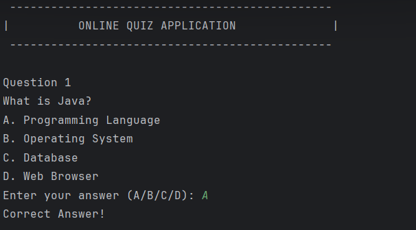
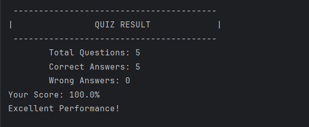

# Online Quiz Application

## About the Project
This is a Java-based Online Quiz Application that allows users to answer multiple-choice questions (MCQs) and calculates their final score.

## Features
- Display multiple-choice questions.
- Capture user answers.
- Check correct and incorrect answers.
- Calculate the final score.
- Display quiz results and performance feedback.

## Technologies Used
- Java
- IntelliJ IDEA
- Object-Oriented Programming (OOP)

## Project Structure
```text
OnlineQuizApplication/
│
├── src/
│   ├── Question.java
│   ├── Quiz.java
│   └── Main.java
│
├── screenshots/
│   ├── QuizHome.png
│   └── QuizResult.png
│
└── README.md
```

## How to Run
1. Clone or download this repository.
2. Open the project in IntelliJ IDEA.
3. Run `Main.java`.
4. Answer the multiple-choice questions.
5. View your final quiz results.

## Concepts Used
- Classes and Objects
- Constructors
- Encapsulation
- ArrayList
- Loops and Conditional Statements
- Scanner for User Input

## Screenshots

### Quiz



### Quiz Result



## Author
Chathurani Thuduwage

## Internship Task
Task 06 – Online Quiz Application  
Java Development Internship – Auspify Technologies
